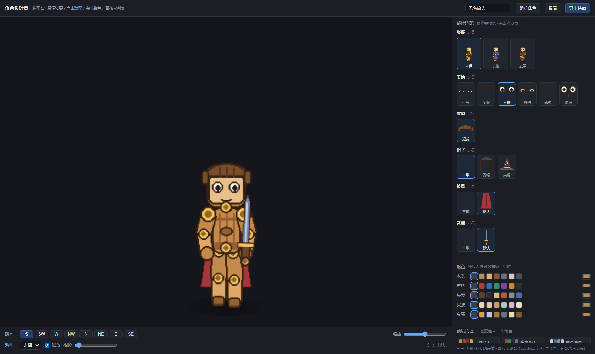
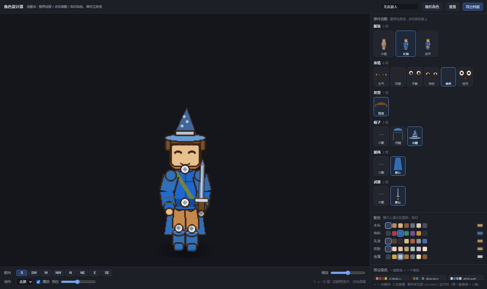
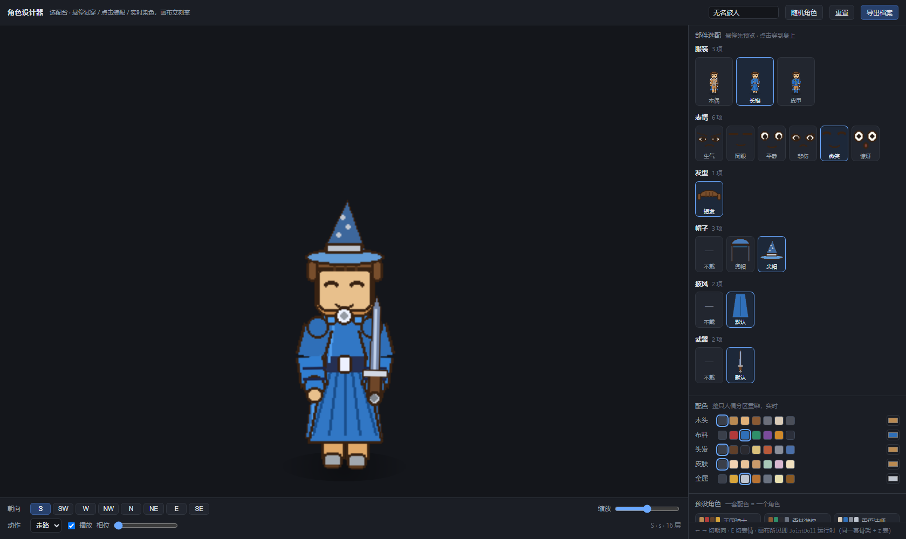

# 给纸娃娃装上试衣间：一个能实时选配的网页角色设计器

> 最近在做一个 Godot 的小项目，角色是"关节木偶"：身体被拆成十几个部件图层，
> 挂在一套 2D 骨架上。部件一多，"换一个部件看效果"就成了日常刚需——
> 总不能每画一顶帽子就开一次游戏截图。于是有了这个角色设计器：
> 一个 300 KB 的单文件网页，打开就能给木偶换装、染色、转视角，所见即所得。



## 它长什么样

右边是**部件货架**，按"服装 → 表情 → 发型 → 帽子 → 披风 → 武器"分类，每类一排缩略图。
左边是画布，一个正在走路的关节木偶。

三条交互规则，对着小红书那个"木头人换部件变角色"的视频抄的：

1. **悬停即试穿**。鼠标扫过任何缩略图，画布立刻穿上这件给你看；
   移开就恢复，点一下才保留。下图里画布已经是皮甲，货架里选中的还是长袍——
   状态栏写着"试穿预览中，点击保留"。



2. **服装按整套换**。长袍、皮甲不是单个躯干贴图，而是"躯干+四肢+靴子"的一组。
   单换一块躯干会出袍子配木头胳膊的怪组合，所以换装永远整套切换。
   每个服装卡片上画的是一只**迷你真人偶**——用和大画布完全相同的骨架渲染出来的，
   不是平面图标，选之前就能看到这件衣服上身什么样。



3. **配色是全局染缸**。木头、布料、头发、皮肤、金属五个色板，
   选一个颜色，所有部件的对应区域一起变色——包括货架上的缩略图和迷你人偶。
   变色不是换图，是页面里用 canvas 像素循环复刻了游戏 shader 的 HSV 换算，
   所以"网页里染出来的颜色"和"游戏里最终的颜色"是同一套数学，不会货不对板。

## 为什么网页能和游戏画得一模一样

设计器不是"示意动画"，它就是把游戏运行时的渲染逻辑用 JS 重述了一遍：

- **同一副骨架**。关节坐标、父子关系、每个槽位挂在哪个关节，全部从
  `layer_rules.json` 读出来打包进页面；
- **同一张 z 表**。十六个槽位在每个朝向下的图层顺序直接抄游戏快照，
  武器在背面朝向时要塞进披风后面（z 50 → 21）这种规则也一并生效；
- **同一套步态公式**。摆臂、屈膝、身体起伏的三角函数和 Godot 里的
  `_pose_walk` 逐行对应，连肘部常驻弯角的常量都是打包时从 gd 源码正则读的，
  两边永远不可能各写一个数。

所以画布所见，就是 `JointDoll` 运行时。

## 八个朝向只画五张图

美术上有个划算的取舍：游戏存 5 个视图（正、西南 3/4、侧、西北 3/4、背），
另外三个朝向（东北、东、东南）靠水平镜像补出来。同一个木偶转一圈是这样：


代价是两条规矩要写进规范：

- 左右不对称的装饰（单边耳环、歪帽子）在镜像视图里会翻到另一边；
- 3/4 视图的暗面朝向必须和图层远近侧同侧——美术把哪条胳膊压暗，
  z 表就得把哪条当"远侧"，反了就会读出"肩膀长到背后去"的鬼畜画面。
  这条我们用脚本对像素断言，不靠肉眼。

## 染色的门是 R 通道

分区染色靠一张遮罩图：纯红 = 主色区，黄 = 皮肤，品红 = 金属，透明 = 保持原色。
shader 最后一步是 `mix(base, color, mask.r)`——**R 通道是总开关**。
我们曾把金属区写成 `(0,0,255)`，看着"编码"了，R 却是 0，
金属调色被整个门控掉，三行验证图长得一模一样还以为验证通过了。
这条坑现在进了验收脚本的断言：遮罩内 G/B 有值而 R=0 的像素，直接报错。

## 素材怎么进场

新部件交付走三条命令：

```bash
python tools/import_part.py --art 我画的帽子.png \
       --slot hat --variant tophat --view s --metal-colors "#f0c45c"
python tools/check_part.py --slot hat --variant tophat     # 验收门禁
python tools/gen_character_designer.py                     # 上货架
```

收图工具负责把任意尺寸的 RGBA 图缩放、alpha 二值化成硬边、
把 `--pivot` 指定的像素对齐到该槽位的关节、按色距自动生成染色遮罩。
验收门禁每条规则都是踩坑记录：贴边被裁、挂点漂移、缺视图、半透明串色、
遮罩 R=0 陷阱、和默认变体的中轴偏移……

给美术（或给图生图）的对齐参考长这样——五个视图并排，
垫着半透明的现有素材，标了地面线、中轴、挂点和包围盒：


整套交付规范（尺寸、坐标、槽位表、打勾清单、退回原因）在
`docs/素材清单.md`，表格数据是从现有素材实测的，重跑一个脚本自动更新。

## 一点体会

这类"小而完整"的工具最容易死在两件事上：一是**验证靠肉眼**——
坐标错了 5 像素，截图上看不出来，转起来才穿帮，所以能写成断言的都写了脚本；
二是**规范和现实脱节**——文档说脚底在 y=216，美术早改到 y=210 了，
所以规范文档干脆也由脚本从素材实测生成，谁也不会撒谎。

下一步打算让"导出档案"直接写回游戏配置，网页里点出来的角色
在启动参数里就能一键复现。部件库继续扩：发型、肩甲、尾巴、翅膀，
架子已经搭好，往里放图就行。
