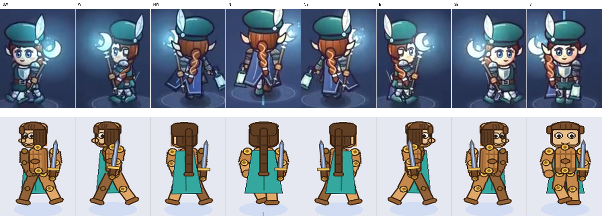

# 纸娃娃 2D 沙盒 · 技术方案 v4（枢轴人偶 + 正弦驱动 + 弹簧）

> 参考对象：小红书「零号su」
> · 开发日记 1《一个木头人，怎么变成 16 个角色》
> · 开发日记 2《角色是怎么动起来的》
>
> 引擎：**Godot 4.7.2**（`F:\Godot\Godot_v4.7.2-stable_win64.exe`）
> 项目路径：**`F:\aiprojects\paperdoll-like`**
> 视角：俯视 8 方向

---

## 0. 结论先行

开发日记 2 里，作者把动画方案讲得很直白：

> 「答案是没有一帧动画是画的」
> 「每块都是一张静止的图，钉在关节上」
> 「直接平移，就是一张图在地上滑」

这意味着：

**没有逐帧动画，也没有蒙皮。** 每块碎片是一张静态 PNG，钉在一个关节（枢轴）上；关节的旋转角度由**正弦波**实时算出来。披风的甩动，是另一个东西——一个挂在关节上的**弹簧**（头发不参与，见 §5.0）。

所以本项目的架构在 v4 做了一次方向修正：

| | v1 帧动画纸娃娃 | v2 实时骨骼 + 蒙皮 | v3 骨架烘焙成帧表 | **v4 枢轴人偶（当前）** |
|---|---|---|---|---|
| 动画载体 | 手绘序列帧 | Bone2D 实时变形 | 烘焙图集，帧号驱动 | **关节角度实时计算** |
| 动画资产 | 每部件 100 帧 | 0 帧 | 每部件 32 组图集 | **0 帧** |
| 需要蒙皮 | 否 | 是（Godot 手涂权重） | 否 | **否** |
| 弹簧次级动画 | 可（画出来） | 可 | **不可实现** | **可** |
| 改一个姿势的成本 | 重画 | 改曲线 | 重烘 8 方向 | **改一个数值** |
| 状态 | 归档 | 归档 | 归档 | 运行中 |

**v3 被推翻的原因是它做不到弹簧。** 弹簧的响应取决于「过去任意时刻的加速度」——角色什么时候停、停得多急，都是运行时的。烘焙成固定帧，等于把所有可能的停止时机都提前画一遍，不可能。而这一期视频里，作者花了一半篇幅讲弹簧甩动。

---

## 1. 参考实现的真实技术（逐条对应）

下面每一行左侧都是视频里的原话（字幕原文），右侧是我方实现的位置。

| # | 视频原话 | 技术含义 | 本项目实现 |
|---|---|---|---|
| 1 | 「每块都是一张静止的图，钉在关节上」 | 碎片化 + 枢轴绑定，无蒙皮 | `JointDoll.JOINTS` 枢轴表 + `SLOT_JOINT` 槽位映射 |
| 2 | 「直接平移，就是一张图在地上滑」 | 位移不等于走路，必须有关节摆动 | `demo/joint_demo.gd::_patrol` 只改 `position`，摆动由曲线负责 |
| 3 | 「让腿按正弦波来回摆」 | 关节角 = sin(ωt) | `_pose_walk()` 中 `hip_l/hip_r` |
| 4 | 「两条腿正好相反，一前一后」 | 相位差 π | `sin(w)` 与 `sin(w + PI)` |
| 5 | 「手跟腿反着摆」 | 同侧手臂取同侧腿的反相 | `shoulder_l = arm·sin(w+π)`，`shoulder_r = arm·sin(w)` |
| 6 | 「手摆反了，就成了同手同脚」 | 相位错了立刻能看出来 | 这一条是全篇最容易写错的地方，见 §4.4 |
| 7 | 「腿摆一个来回，身体颠两次」 | 竖直位移取 **2× 频率** | `_set_bob(bob·sin(2w + π/2))` |
| 8 | 「三条曲线叠起来就是走路」 | 腿两条 + 身体一条 | 见 §4.1 公式 |
| 9 | 「正面看腿没法前后摆，就改成左右交替抬脚」 | **不同视图需要不同曲线** | `PROFILE[mode]`：0=前后摆，1=交替抬脚 |
| 10 | 「八个方向我只画了五个，左边三个是右边翻过来的」 | 5 视图 + 镜像 = 8 方向 | `DIR_TO_VIEW` 表，镜像在整只人偶上做 |
| 11 | 「代价是往右走右手拿剑，往左一转就成了左撇子」 | 镜像翻转了不对称部件 | 作者**接受**了这个代价；需要时用 `no_mirror` 单独画满 8 列 |
| 12 | 「一转身背面的披风却不见了」 | z 序不能全局固定 | `Z_ON_BACK` 逐方向覆盖表 |
| 13 | 「所以每个方向都单独排了一遍图层」 | 每个方向一套 z 表 | 同上，见 §7 |
| 14 | 「身体停了，头发不该马上跟着停」 | 次级动画要有惯性（谁在甩见 §5.0） | `SpringJoint` 二阶阻尼振子 |
| 15 | 「其实就是给头发挂了一根看不见的弹簧」 | 弹簧约束（作者口语；画面上动的是披风） | 默认只给披风挂；头发走 `spring_on_hair` 开关 |
| 16 | 「拉开就往回弹，阻尼让它慢慢停下」 | 阻尼耗能 | `-damping·ω` |
| 17 | 「阻尼太小，停下来还一直晃」 | 欠阻尼 | 实测见 §5.4 |
| 18 | 「阻尼是负数，越晃越大，直接甩飞」 | 负阻尼自激发散 | 实测见 §5.4 |

**人物设计层面的关键洞察（这才是「人物设计」真正的含金量）**

视频里那个木头人被拆开的瞬间（第 8 秒左右），每块碎片上都有一个**金色的圆形球关节**：肩、肘、髋、膝各一个。

这不是装饰。它是 cutout 动画的美术解法：

- 刚性碎片拼接必然有缝。硬要无缝，就得蒙皮、就得让袖子跟着弯。
- 但如果你把角色设定成**木质人偶 / 发条玩具**，「看得见的球形关节」就变成了世界观的一部分，缝不再是缺陷，而是特征。
- 于是：**不需要蒙皮、不需要无缝、不需要关节遮盖**，美术和工程同时省掉一大块。

同理，其他角色（法师、骑士、精灵）用长袍、护肩、披风把关节包起来——同样是让「看不见的关节」不成为问题。

> 这就是本项目的美术铁律：**要么关节外露（木头人），要么关节被布料盖住（袍子），不允许「关节半露不露」。**

---

## 2. 为什么推翻了 v3

v3 的方案是「骨架摆姿势 → 逐部件渲染成 8 方向 × N 帧图集 → 运行时按帧号叠图」。它在**观感**上和参考实现接近，但有三个硬伤：

**① 弹簧做不了。** 这是致命的。帧表是离散的、预生成的；弹簧是连续的、依赖运行时加速度历史的。

**② 资产量翻 32 倍。** 每个部件要 8 方向 × 4 动作 × N 帧 ≈ 32 组图集；v4 只要 5 张静态图。

**③ 改一处要全量重烘。** 调一下手臂角度，230 个部件全部重渲（实测 90 秒/11 部件，外推 32 分钟）。v4 改一个数是即时的。

v3 唯一的优势是「姿势完全可控、可以摆出任意复杂动作」。v4 的正弦驱动只能做程序化动作（走、跑、待机、攻击），做不了「翻跟头」。

对本项目（俯视沙盒、角色小、同屏多）来说，这个损失可以接受——参考视频的作者也是这么取舍的。

---

## 3. 枢轴层级

### 3.1 枢轴表

`core/character/joint_doll.gd::JOINTS`，格式 `[关节名, 父关节, 画布坐标]`，顺序即前序遍历，父必须在子之前。

```
hip         (128,146)  ← 根
├ chest     (128,110)
│ ├ head    (128,100)
│ ├ shoulder_l (108,108) → elbow_l (102,130)
│ └ shoulder_r (148,108) → elbow_r (154,130)
├ hip_l     (120,152) → knee_l (119,182)
└ hip_r     (136,152) → knee_r (137,182)
```

11 个关节。够用：躯干 1、头 1、手臂 4、腿 4。

肩枢轴 108/148 是**收在躯干轮廓（128±16）里面 4px** 的，不是随便挑的：
放在轮廓外（旧的 104/152）时球心到桶边 8px，肩球只能和桶边相切，
静止就有一条背景缝、摆臂更宽 —— 见 §8.2.1。肘一起平移，上臂斜度不变。

### 3.2 坐标对齐（这里有个必须写对的推导）

贴图按**画布坐标**绘制（256×256，脚底锚点 (128,216)），而枢轴节点绕**自己的原点**旋转。要让画布上的点 `c` 在枢轴 `G` 旋转后落在 `G + R·(c − G)`：

```
枢轴节点放在画布坐标 G 处
Sprite 子节点的 position = −G
```

因为 `T(G) · T(−G) · c = c`（静止时一一对应），加上旋转后 `T(G) · R · T(−G) · c = G + R·(c − G)`，正好是绕 `G` 旋转。

写错成 `position = −ANCHOR − G` 之类，所有部件会整体偏移或塌到一点——这是 v1/v2 都踩过的坑。

### 3.3 槽位 → 关节

```
body/clothes        → hip
cape                → chest（挂弹簧）
head/hat/hair_*     → head（hair_* 默认刚性，见 §5.0）
arm_l/arm_r         → shoulder_l/shoulder_r
fore_l/fore_r       → elbow_l/elbow_r
weapon/offhand      → elbow_r/elbow_l（和 fore_* 同一个枢轴 = 天然握持）
leg_l/leg_r         → hip_l/hip_r
shin_l/shin_r       → knee_l/knee_r
```

一个关节上可以挂多块碎片（头 + 前发 + 后发 + 帽子都钉在 head 上），靠 `SLOT_Z` 排序。

**武器为什么不用单独建一个 hand 关节**：`fore_r` 和 `weapon` 都挂在 `elbow_r`、绕同一个枢轴转，
相对位置恒定。所以只要美术里「柄落在手心」，跑起来永远是握着的，
不需要每帧反算手的世界坐标再摆武器。多一个 hand 关节只会多一层要维护的枢轴。

---

## 4. 步态：三条正弦曲线

### 4.1 公式

设步幅相位 `p ∈ [0,1)`，`w = 2πp`：

```
hip_l.rotation     =  A_leg · sin(w)
hip_r.rotation     =  A_leg · sin(w + π)
knee_l.rotation    = −A_knee · max(0, −sin(w + 0.55))
knee_r.rotation    = −A_knee · max(0, −sin(w + π + 0.55))
shoulder_l.rotation =  A_arm · sin(w + π)      ← 与同侧腿反相
shoulder_r.rotation =  A_arm · sin(w)
chest.rotation     = −1.6° · sin(w)            ← 上半身轻微反扭
head.rotation      =  +1.6° · sin(w)           ← 头部抵消，避免整块木头在晃
hip.position.y     =  A_bob · sin(2w + π/2)    ← 2× 频率
```

膝盖只在腿往后走时弯（`max(0, −sin)`），因为另一条腿是伸直的——这条如果写错，走起来会像在踩缝纫机。

### 4.2 按视图收敛幅度

俯视 8 方向里，同一个动作在不同视图上的视觉幅度完全不同。侧视看到的是腿的前后摆，正视看到的是两条腿的错位。**所以幅度表必须是 per-view 的**：

| 视图 | 腿 | 臂 | 起伏 | 膝 | 抬脚 | 曲线类型 |
|---|---|---|---|---|---|---|
| S 正 | 0° | 4° | 2.2px | 0° | **7px** | 竖直抬脚 |
| SW 前左 | 19° | 13° | 2.5px | 16° | — | 前后摆 |
| W 侧 | **26°** | **18°** | **3.2px** | 22° | — | 前后摆 |
| NW 背左 | 19° | 13° | 2.5px | 16° | — | 前后摆 |
| N 背 | 0° | 4° | 2.2px | 0° | **7px** | 竖直抬脚 |

正/背视如果照搬侧视的 26°，会看起来像「横着走」——腿在屏幕上左右劈叉。这就是视频里那句「正面看腿没法前后摆」的原因。

### 4.2.1 正/背面的抬脚必须是**竖直**的（一个角度都不能加）

`mode` 1 曾经写成「膝盖转 −30° 做抬脚」。这在屏幕平面里把小腿连同脚一起转过去了：

- 脚会甩到腿的**左边或右边**，还带一个斜面 —— 朝镜头走路时最刺眼的那种错；
- 脚不再是「正对镜头」的，方向被转没了。

前后方向的位移投影到屏幕上**不是旋转，是缩短**。所以 `mode` 1 一个角度都不加，只做竖直平移：

```
hip_l.position.y = −lift · max(0, sin w)      ← 整条腿抬起
hip_r.position.y = −lift · max(0, sin(w+π))
```

大腿顶端本来就沉在躯干（y≤152）后面，抬起来只是让**露出来的那段变短**——这正是「腿朝镜头迈出去」的缩短投影，而脚始终保持水平、正对镜头、骑在脚踝正中。

`tools/gait_probe.gd` 把这条钉成断言：正/背面整周期里膝盖节点的 **x 位移必须是 0.000px、转角必须是 0.00°**，同时 y 位移必须 ≥3px（抬脚还在）；侧面/斜角反过来必须有角度或位移，防止把摆动误删了。

### 4.3 其余动作

| 动作 | 实现 | 时长 |
|---|---|---|
| `idle` | 呼吸：chest ±1.2°、头反向 ±0.8°、手臂 ±2°、起伏 0.9px | 循环 |
| `walk` | §4.1 | 循环，`stride_time` 默认 0.78s |
| `attack` | 右肩 −95°→回，胸 +7°，头 −5° | 0.45s，非循环 |
| `hurt` | 胸 −14°、头 −16°、双臂 −22°、整体下沉 2px | 0.4s，非循环 |

### 4.4 最容易写错的一行

「手跟腿反着摆」——反的是**同侧**腿，不是对侧。

```
左腿向前（sin(w) > 0）  →  左臂向后（sin(w+π) < 0）
```

写成同相就是视频里那句「成了同手同脚」。这条错误在代码里只有两个字符的差别，但一眼就能被看出来，所以 §4.1 的公式必须和代码保持一致。

---

## 5. 弹簧次级动画

### 5.0 二次复核：被甩出去的是披风，不是头发

第一版把 `hair_back` / `hair_front` / `cape` 三个槽位全挂了弹簧。回头逐帧核对视频后，这个做法是错的，改掉了。

**视频里能看到的（54.4s ~ 65.6s 逐帧）**

| 观察点 | 事实 |
|---|---|
| 「弹簧 关 / 弹簧 开」两栏对比（k_09 帧） | 两个角色的**头发轮廓逐像素一致**，只有红色披风的角度不同（贴背 → 后扬） |
| 慢放连拍 6 帧（54.4–58.0s） | 头像整体位置随身体移动，但**发型轮廓一帧都没变**；披风下摆每帧都在变 |
| 角色设定 | 作者的头发是**编辫 / 一整片硬质发片**，贴着头骨，不是散发 |
| 字幕原话 | 「慢放着：右边的**头发和披风**往前一甩」——作者口语把两者并称，但画面只兑现了披风 |

**所以正确的产物是：**

- `hair_front`（刘海）**永远刚性**。它贴在额头上，一旦挂弹簧就会在脸上甩，视觉上就是「假发飞了」。
- `hair_back`（后发）默认也刚性 —— 钉在头骨上，只跟着 `head` 关节整体旋转。
- 只有 `cape` 挂弹簧。
- 需要「长马尾 / 散发」的角色时，把 `JointDoll.spring_on_hair` 打开，此时**只**给 `hair_back` 挂，枢轴在发根 `(128, 62)`（不是脖子）。

**顺带的两个修正**

1. `_spring_pivot(hair_front)` 原来返回 `(128, 100)`，正好是脖子 —— 刘海绕脖子转，急停时会横着扫过整张脸。
2. 背面 z 序 `Z_ON_BACK[hair_back]` 从 24 改成 **31**：原来低于 `head`(30)，转身后后脑是一块光木头；视频里转身看到的是头发。

自检（`--selftest`）：

```
默认         : [&"cape"]   (spring_on_hair=false)
打开头发弹簧 : [&"cape", &"hair_back"]
关回来       : [&"cape"]
```

### 5.1 模型

把披风当成**挂在移动支点上的单摆**，支点就是它挂的那个关节（披风挂 chest；开了 `spring_on_hair` 时后发挂 head）。四项力：

```
支点加速度 a  → 惯性伪力   → 角速度增量  +inertia · a · dt
支点速度 v    → 空气阻力   → 角速度增量  +drag · v · dt
角度偏离 0    → 回弹弹簧   → 角加速度    −stiffness · θ
角速度 ω      → 阻尼耗能   → 角加速度    −damping · ω
```

积分（半隐式欧拉）：

```
vel += (inertia·ax + drag·vx) · dt
vel += (−stiffness·θ − damping·vel) · dt
θ   += vel · dt
```

**关键：冲量必须积分成「角速度」，不能直接当「目标角」。**

第一版我把加速度映射成 `target = ax · k`，结果急停只产生一帧脉冲，头发几乎甩不起来（实测急停前甩只有 −2°）。改成积分进角速度之后，同样是 100 px/s 急停，前甩变成 −10.4°，观感立刻对了。

### 5.2 符号

正角度让下垂部件（局部尖端在 `(0, +L)`）往 **−x** 摆：

```
旋转 θ 后尖端 = (−L·sinθ, L·cosθ)
```

- 向右走：空气把披风往左推 → 尖端偏左 → θ > 0
- 向右急停：惯性让披风继续往右 → 尖端偏右 → θ < 0

所以 `inertia` 和 `drag` 两项**同号**。写成一正一负，走路时披风会往前飘，看着像在倒退。

### 5.3 参数

| 参数 | 默认 | 作用 | 调大的效果 |
|---|---|---|---|
| `stiffness` | 90 | 回弹刚度 | 变硬、回弹快、幅度小 |
| `damping` | 5.5 | 阻尼 | 晃得少、停得快；**< 0 会发散** |
| `inertia` | 0.035 | 惯性增益 | 急停时甩得更狠 |
| `drag` | 0.10 | 空气阻力 | 行走时后拖更明显 |
| `max_angle` | 0.85 rad | 摆角上限 | 防止极端参数甩出画布 |

### 5.4 实测（`tools/spring_probe.gd`，纯数值不渲染）

输入速度曲线：0–0.2s 加速到 100 px/s，保持到 0.8s，**0.8s 瞬间停住**。

| 工况 | 行走时后拖 | 急停瞬间前甩 | 平息用时 | 结论 |
|---|---|---|---|---|
| 正常 k=90 c=5.5 | +15.9° | **−10.4°** | 0.68 s | 目标行为 |
| 阻尼太小 k=90 c=0.6 | +17.4° | 持续 ±15° 振荡 | 未平息 | 对应「停下来还一直晃」 |
| 阻尼为负 k=90 c=−3.0 | 振荡放大至 ±48.7° | 发散 | 永不 | 对应「越晃越大，直接甩飞」 |
| 过硬 k=400 c=7 | +3.0° | −4.0° | 0.45 s | 像塑料假发 |

运行时（引擎内实拍，`--strip` 模式打印，头发刚性 / 只留披风）：

```
t=00  头发:刚性 0.0°   披风:+6.5°    ← 停住瞬间，还在往后拖
t=05  头发:刚性 0.0°   披风:−9.8°    ← 甩到最前
t=11  头发:刚性 0.0°   披风:−0.1°    ← 0.44s 内回正
```

打开 `spring_on_hair` 之后（同一段测试，hair_back 绕发根）：

```
走 0.8s 后 hair_back = +7.05°       ← 匀速行走时的稳定后拖
急停后同样按 k=90 c=5.5 衰减
```

---

## 6. 视图与镜像

5 套视图 + 镜像补 3 个方向 = 8 方向，省 37.5% 绘制量（作者的算法和数字都一样）。

### 6.0 8 个方向在画面上怎么摆

视频里那 8 个角色**不是排成一行**，而是围成一个被压扁的圆（约 20s 那段，字幕「左边三个，是右边翻过来的」）。量出来的坐标（1280×720 帧，以 8 只的重心为原点）：

| 方向 | Δx | Δy |
|---|---|---|
| N | 0 | −130 |
| NE | +319 | −98 |
| E | +456 | −3 |
| SE | +292 | +95 |
| S | 0 | +140 |
| SW | −294 | +95 |
| W | −456 | −3 |
| NW | −319 | −99 |

水平和垂直半径比 **456 : 135 ≈ 3.4 : 1**，斜向四点落在 `(±R·0.707, ∓R·0.707)` 上 —— 这是标准的**俯视等角投影**：地上一个半径 R 的圆，投影到屏幕上 y 方向压扁 3.4 倍。所以不能按屏幕角度均匀摆 8 个（那样斜向四点会挤在上下两个旁边），必须**椭圆参数化**：

```gdscript
# demo/joint_demo.gd
const RING_CENTER := Vector2(640.0, 358.0)
const RING_RX := 452.0
const RING_RY := 132.0
const RING_T := [270.0, 225.0, 180.0, 135.0, 90.0, 45.0, 0.0, 315.0]  # E=0°，每格 45°

func _ring_pos(dir: int) -> Vector2:
	var t := deg_to_rad(RING_T[dir])
	return RING_CENTER + Vector2(cos(t) * RING_RX, -sin(t) * RING_RY)
```

N 和 S 之间那条竖虚线是**镜像轴**（`_draw()` 里画的，角色 z 更高所以会挡住它，和视频一致）。每只脚下还有一个压扁的椭圆光环，同样是等角投影的地面圈。

复刻结果（上=视频，下=本项目，同列同方向）：



> **记账方向是反的，画面是等价的**：视频里「左边三个由右边翻出」，本项目是「右边三个由左边翻出」（`DIR_TO_VIEW` 里 mirror=1 的是 NE/E/SE）。因为镜像对称，8 张画面完全一致，只是「谁是原图」不同。要改成和视频同向，把 `sw/w/nw` 三张图画成朝右、再把 mirror 标志挪到左侧三个方向即可。

### 6.1 方向 → 视图

| 目标方向 | S | SW | W | NW | N | NE | E | SE |
|---|---|---|---|---|---|---|---|---|
| 视图来源 | s | sw | w | nw | n | **nw 镜像** | **w 镜像** | **sw 镜像** |

**所以 NW 必须是「背面偏左」，不是「正面偏左」。** 因为它要镜像出 NE（背面偏右）。画成正面偏左，镜像出来的 NE 就是正面偏右，整个转向逻辑就崩了。

### 6.2 脸的角度：5 套视图各画成什么样

这是二次复核的重点。把视频 8 方向那张图（约 20s）放大到每个角色 100px 逐个数：

| 视图 | 视频里的脸 | 判定依据 |
|---|---|---|
| `s` 正面 | 双眼正对镜头，眼距最宽 | 两只眼完全对称 |
| `sw` 3/4 | **双眼**，但靠后那只被鼻梁压窄，鼻尖从行进侧凸出 | 仍是两只眼，只是偏 |
| `w` 侧面 | **单眼**，鼻尖凸出轮廓，后脑是头发 | 另一只眼完全没有 |
| `nw` 背面 3/4 | 看不到任何五官 | 后脑 + 头发 |
| `n` 背面 | 看不到任何五官 | 后脑 + 头发 |

第一版这三条全踩了：

1. `sw` 用 `look=-5`（头只偏 2.8px）+ `narrow=0.92` —— 画出来和正面几乎一样，**3/4 和正面分不出来**。
2. `hair_front` 的 pieslice 从 y=49 画到 y=91，把眼睛（y 71~83）整个盖住 —— 角度画对了也看不见。
3. 背面 `Z_ON_BACK[hair_back]=24 < head 30` —— 转身后后脑是一块光木头。

现在统一用**一个 `turn` 参数**驱动整颗头（`tools/gen_joint_art.py::head`）。转身由四件事共同表达，**掉任何一件都会变成"正脸贴歪了"**：

```
1. 头骨（桶）宽度几乎不变      圆柱正投影宽度恒定，只按 narrow 微收 14%
2. 脸（前面板）贴住朝向前侧的脸骨边缘，宽度 = (2hw−3)·(1 − 0.55t)，绝不越出轮廓
3. 远侧那只眼被鼻尖压扁        半径 ×(1 − 0.45t)，并往脸缘挤
4. 后脑那侧压暗 + 头发压下来   和躯干同一条「背面在哪边」规则
```

第 2、3 条是这一轮改出来的。改之前是「整张脸等比缩小 + 整体左移」：

- **脸会从左边溢出脸骨**（`fw = half·(1−0.30t)` 加 `off = −half·0.40t`，t=0.8 时脸的左缘比头骨左缘还外 8px），看起来像一张脸贴在木桶外面；
- **被压扁的偏偏是近侧那只眼**（`ew` 判据写成了 `sx > 0`），而鼻尖和整体位移都在说"朝左"。两个方向信号互相打架 —— 这是"斜角头和身体不一致"的第一层原因。

现在改成：脸锚在脸骨朝向侧的边缘往里收，远侧眼压扁、近侧眼保持圆。**方向感主要由眼距和远侧眼的压缩承担**，位移只做辅助。

`hair_front` 收窄到 y 50~68（眉毛以上），眼睛 71~83 全部露出 —— 这是"脸的角度能看出来"的前提。鬓角从 y 60~84 收到 y 58~74：原来一直压到嘴边，正面看像长了胡子。

**背面视图也必须吃 `turn`。** 原来 `nw` 只改 `look` 不改 `turn`，画出来和 `n` 是同一张图 —— 斜向那两格等于白画。现在头发块按 `turn` 朝后脑侧偏，另一侧露耳朵 + 一小条脸颊。

核对方法：`--shot` 截图后用 `python tools/... ` 按环上坐标裁 8 格（`docs/faces_8dir.png`），
再和 `docs/ring_compare.png` 逐列对方向。

镜像在**整只人偶**上做（`scale.x = -1`），不是逐图层 `flip_h`——逐图层翻转只翻贴图不翻枢轴，图和旋转中心会错位。

**代价**：镜像会让不对称部件左右互换。视频里作者的原话是「往左一转，就成了左撇子」，他的结论是「小角色上，我接受这个代价」。

本项目同样接受，但保留了出口：`PartDef.no_mirror = true` 的部件，画面上不翻转（`_apply_view()` 给它单独再乘一次 `scale.x=-1` 抵消）。哪些部件必须画满 8 列，见 §8.4。

> **注意**：`no_mirror` 只能让图案不翻，救不了「部件位置应该在另一侧」（比如分缝换边）。
> 这类得上左右两版美术。逐条见 `docs/八向缺陷清单.md` §3.2。

---

## 7. 逐方向 z 序

固定 z 序会在转向时穿帮，而且是**两层穿帮**，得分开处理。

### 7.1 第一层：前后关系随方向反转

最典型的就是视频里点出的那个：**一转身，背面的披风不见了**——因为披风 z=2 在身体 z=10 之后，正面看是对的（披风在背后），背面看就错了（应该盖在身前）。

解法是一张**逐方向覆盖表**（`JointDoll.Z_ON_BACK`）：

| 槽位 | 默认 z | 背面朝向（NW/N/NE） |
|---|---|---|
| `cape` | 2 | **22**（盖住身体 10 和衣服 20） |
| `hair_back` | 0 | **31**（盖住 head 30——转身看到的是头发，不是光木头） |
| `hair_front` | 34 | **0**（背面不许有刘海） |
| `face` | 32 | **0**（背面不许有五官） |
| `wing` | 4 | **16** |
| `tail` | 5 | **16** |
| `offhand` | 48 | **8** |
| `shoulder` | 26 | **21**（跟着手臂收进布后） |
| `weapon` | 50 | **21**（v3：跟着拿剑的手收进布后，见 §7.2.1） |

`weapon` 这条也反转过一次：v2 之前故意不在这张表里（背面持剑仍画在身侧），
后来发现手臂已藏进布里，布上却浮着一把凭空出现的剑，才跟着手一起沉到 21。
「背在背上的剑」是另一个槽位（比如 `back_weapon`），与本条无关。

### 7.2 第二层：近侧/远侧的肢体要换边

这一层比第一层隐蔽得多，也是我们一开始漏掉的。

`scale.x = -1` 翻的是**屏幕左右**，不是**深度**。所以「哪条腿在前、哪只胳膊离镜头近」
在镜像后完全不变；但人绕着镜头转的时候，远近是会换的。

只用一套固定 z，转身到背面 3/4（NW/NE）时，近侧胳膊仍沉在躯干后面 —— 走路时会在胸口忽隐忽现。

解法：四肢的 z 拆成两套（`JointDoll.LIMB_Z`），按**视图**查（`NEAR_SIDE`），
因为镜像不改变远近，NE 和 NW 必须用同一套。

| 槽位 | 近侧 | 远侧 |
|---|---|---|
| `arm_l` / `arm_r` | 13 | 8 |
| `fore_l` / `fore_r` | 14 | 9 |
| `leg_l` / `leg_r` | 8 | 6 |
| `shin_l` / `shin_r` | 9 | 7 |
| `shoes_l` / `shoes_r` | 9 | 7 |

| 视图 | S 正面 | SW | W 侧面 | NW | N 背面 |
|---|---|---|---|---|---|
| 近侧 | —（对称） | r | r | **l** | —（对称） |
| 远侧 | —（对称） | l | l | **r** | —（对称） |

**前后 3/4 的远近是反的，这是最容易写错的一格。** 角色绕竖直轴转 θ，
贴图 x<128 那一侧（记作 `"l"`）的方向是 `(cosθ, sinθ)`：

- θ=45°（SW）：`cos45 > 0`，它在屏幕右、且 `sin45 > 0` 往画面里走 → **远侧**；
- θ=90°（W）：`cos90 = 0`，投影到中线，但仍是同一只手 → 近侧还是 `r`；
- θ=135°（NW）：`cos135 < 0`，它已经转到**屏幕左**、且 `sin135 > 0` 朝镜头 → **近侧翻成 `l`**。

NW 是八向里唯一「近侧在贴图左边」的视图。这里曾经写成 `"r"`，症状不是抽象的：
美术把 `"r"` 压暗、缩小、往里收（`far_limb`），z 表却把 `"r"` 抬到躯干前面 ——
**暗的、缩小的那条胳膊压在身体上，亮的那条沉到背后**，读起来就是
「近侧肩膀长到背后去了」。`tools/check_parts.py` 现在直接比两条胳膊的平均亮度，
断言「美术压暗的一侧 == z 表当远侧的一侧」，同一类错不会再溜过去。

S / N 两格 `NEAR_SIDE` 记空串（对称视图）：`sinθ = 0`，两条胳膊到镜头等距，
硬挑一个「近侧」只会让其中一条的肩球被躯干切掉半个，正面看着一边大一边小。

### 7.2.1 背面朝向：手臂**收进**披风后面（这条规则反转过一次）

披风挂在后背（背面 z=22，盖住身体 10 和衣服 20）。现在两只手臂连肩球一起
压到 21/20 —— 仍在躯干之前，但被披风盖住。这是**用户拍板的外观**：
披风是一整块裹住后背的布，胳膊垂在身侧本来就该被布挡住。

这条规则改过两轮，两个版本都留着，免得以后又摇摆回去：

| 版本 | 做法 | 结果 |
|---|---|---|
| v0（最初） | 只把「近侧」抬到 24，远侧留在 8 | 远臂（NW 覆盖 x 119–144 vs 远臂 138–155）内半边被布吃掉，且随摆臂周期性整条消失，只剩一把剑浮着 —— 用户原话「内臂摆动时跑到身后去了」 |
| v1 | 双臂抬到 24/23，都压过披风 | 不再消失，但背面看起来像胳膊**贴在红布外面**，肩球像钉在披风上的两枚扣子 |
| v2 | 双臂+肩球收到 21/20（< 披风 22，> 躯干 10）；SW 的远臂整条沉到披风(2)之下（1/1/1） | 背面只见头、披风、腿；手臂被布挡住。但 `weapon` 仍留在布外，红布上浮着一把凭空出现的剑 |
| v3（现在） | `weapon` 也进 `Z_ON_BACK`（50 → 21），跟着拿剑的手一起收进布后 | 背面只见头、披风、腿；剑和手一起被布盖住。SW/W/S 是正面朝向不走这张表，剑仍画在最前。`zdump` 断言 双臂+肩球+武器 < 披风 且 > 躯干 |

副作用是想清楚才用的：**背面视图里手臂和剑完全看不见**（被布盖住）。
当初 v2 把武器留在布外，就是因为"背面持剑还能看见"——实际效果是布上浮着一把
来历不明的剑，v3 按用户拍板反转收进布后。想改回去：删掉 `Z_ON_BACK` 里的
`weapon` 行，再把 `layer_rules.json` 里 nw/n 的 `weapon` 格调回 50 即可。

### 7.2.2 这三层怎么验证

正确性不靠这几张表说服，靠四个地方必须同时成立：

1. `JointDoll.NEAR_SIDE`（z 序，运行时）
2. `gen_joint_art.py::far_limb()`（压暗、收窄、缩小关节，美术）
3. `gen_joint_art.py` 里躯干/头的暗面（按「背面在哪边」，见下）
4. `tools/check_parts.py`（把 1 和 2 的结论用像素对撞一遍）

第 3 条和前两条**不是同一侧**，这点必须说清楚：正面 3/4 时远侧肢体在屏幕左，
而躯干转过去露出来的是**后侧那一块**，在屏幕右。所以暗面跟「背面」走，肢体深度跟「远侧」走。
曾经把两者混成一条，结果是斜角那四格的胳膊横在胸口上。

这套表由 `tools/zdump.gd` 断言，可复跑（见 `docs/八向缺陷清单.md` §5）。

其余槽位用默认表。每加一个「有前后关系的」槽位，就要在 `Z_ON_BACK` 补一行；
每加一条四肢，就要在 `LIMB_Z` 补一对。

### 7.3 结果矩阵外置：可编辑、可预览

前两节加起来是五张互相引用的表（`SLOT_Z` / `LIMB_Z` / `NEAR_SIDE` / `Z_ON_BACK` / `ARM_Z_ON_BACK`），
它们推导出一张 **5 视图 × 27 槽位** 的结果矩阵。想调一个格子的前后关系，
得先判断它受哪张表管、会不会连带影响别的视图 —— 真实的出错方式是「改对了一格、改坏了三格」。

所以结果矩阵外置成 `data/layer_rules.json`（`SLOT_Z` 有 27 项，其中 `summon` 没有挂点、
运行时会跳过，所以 `zdump` 打印的是 26 个）：

| 文件 | 角色 |
|---|---|
| `core/character/joint_doll.gd` | 推导规则（默认值）+ 启动时读 JSON 覆盖 |
| `data/layer_rules.json` | **结果矩阵**，唯一可编辑副本；缺某个格子就退回推导 |
| `tools/dump_layers.gd` | 从推导生成基线（改规则后重跑） |
| `tools/layer_designer.html` | 单文件可视化编辑器：8 方向实时预览 + 矩阵编辑 + 重叠角标 + 错位视图 + 约束自检 + 导出/导入 |
| `tools/gen_layer_designer.py` | 把素材 / 骨架 / 重叠矩阵内联进 HTML（美术或骨架变了才要重跑） |
| `tools/zdump.gd` | 用**运行时**的 z 复核物理不变量（读的就是 JSON） |
| `tools/check_joint_gap.py` | 离线合成也读同一份 JSON，避免工具和游戏各跑一套 |

设计器里能做的事：

- 8 个方向并排，拖相位滑杆（或点播放）看摆臂 —— 静帧看不出层级错，动起来一秒就露；
- 点槽位名 → 只保留那一块，其余淡出，直接看它跟谁打架；
- 直接改数字（↑↓ 微调），行序按 z 自动重排，靠前的在上；改完那一层会闪一下，确认笔画吃进去了；
- **点列头（或点某个预览格）换排序基准列** —— 只看 n 列时，切到 s / w 列去读，相邻的层在表里是散开的；
  z 相同的行会块在一起（层与层之间一道亮线），一眼能数出「这几块同层，再往前一层」；
- 右下角实时跑和 `zdump.gd` **同一套判据**，改错了当场变红；
- 导出 JSON → 覆盖 `data/layer_rules.json` → 跑一次 `zdump.gd` 复核；
- 「打开 JSON」或直接把文件拖进窗口载入外部矩阵（页面里内联的是**打包那一刻**的快照，
  改完 `data/layer_rules.json` 重开 html 看到的仍是旧值，必须喂进来才生效）。

#### 7.3.1 「改了数字，画面却不动」——先看格角的那个数

z 序只在**两张图的像素真的叠在一起**的地方才看得出来。正侧面（W）躯干和披风
投影上根本不碰（实测 0 px），那一格把 `cape` 从 2 改到 999 也不会有任何变化 ——
不是没生效，是几何上无从体现。

所以打包时先算好「每个视图里两两部件不透明像素的交集」（`gen_layer_designer.py::overlap_table`，
阈值 alpha>8，和 `check_parts.py` 一致），内联进页面，显示在每格右上角：

| 视图 | 两两重叠合计 | 最大的一对 |
|---|---|---|
| S / N | 10290 / 9038 px | `body × cape` 1511 |
| SW / NW | 8748 / 7696 px | `hair_back × head` 1325 / 1336 |
| W | 10896 px | `hair_back × head` 1295（**`body × cape` 是 0**）|

选中某个槽位后，角标换成 **`该槽位 ⨯ N px`** —— 0 就是「这一格改它不会有反应」。
这条信息比任何说明文档都直接。

#### 7.3.2 错位视图：不靠重叠也能看前后

碰到重叠为 0 的格子（或者就是想一眼看清整条 z 链），拉「错位」滑杆：
按 z 值把各层沿右上方向推开，像一叠卡片。8 格一致朝同一侧错开
（`.box` 上的 `scaleX(-1)` 会镜像内部平移，所以镜像那三格要反一次符号）。

它只改 `transform` 的平移项、不动 `z-index`，拉回 0 就完全复原 —— 用来读层级，
不用来判断几何。对比图见 `docs/layer_designer_explode.png`。

### 7.4 时间维度：摆动触发的层级切换

静态矩阵表达不了「同一条胳膊，摆到前面时该压在躯干上、摆回去时该沉到后面」。
这是 z 序里唯一随时间变化的部分，写在 `layer_rules.json` 的 `swing` 数组里：

```json
{"slot":"arm_l", "joint":"shoulder_l", "deg":10, "hysteresis":6, "front":13, "back":24}
```

`joint` 的角度 ≥ `deg` 时切到 `front`（背面朝向的那四个方向改用 `back` 这一档），
≤ `deg − hysteresis` 时回落到矩阵里的静态值 —— 两条阈值之间保持原状，这就是迟滞。
`front` / `back` 是「正面朝向时用哪个 z / 背面朝向时用哪个 z」，不是「往前摆/往后摆」，
因为同一个关节角在正背两种朝向下对应的遮挡关系正好相反。

两个约束：

1. **阈值必须大于「手臂刚好脱离躯干轮廓」的角度**，否则切换发生在手臂还压着胸口的那一刻，画面会跳；
2. `hysteresis` 是为了在阈值附近来回摆时不闪。

默认**空着**：按这套几何算下来，两条手臂在各个视图里摆动时都还留在躯干轮廓之外，
不需要动态切换。真要接长兵器 / 盾牌 / 双手握持时，这条才用得上。
`tools/swing_probe.gd` 按 17 个相位扫一遍，断言「该切的切了、该回的回去了」。

> 完整问题清单（26 个槽位 × 已修/未修/无解）见 **`docs/八向缺陷清单.md`**；
> 设计器界面见 `docs/layer_designer_ui.png`。

### 7.5 在 Godot 编辑器里看骨架

**问：为什么打开工程，双击 demo/joint_demo.tscn，视口是空的？**

因为场景文件里真的只有一个节点：

```
[gd_scene ...]
[ext_resource type="Script" path="res://demo/joint_demo.gd" id="1"]
[node name="JointDemo" type="Node2D"]
script = ExtResource("1")
```

11 个关节、14 个精灵、弹簧、标签 —— 全部是 `_ready()` 里用代码 `add_child` 建的。
**编辑器默认不执行 `_ready()`**，能执行的前提是脚本第一行写 `@tool`。之前没写，所以视口空白、
场景面板只有一根节点。这和「贴图丢了 / 图层错了 / 骨骼没绑上」都没关系。

现在 `JointDoll` 和 `joint_demo.gd` 都标了 `@tool`，于是：

| 想做什么 | 打开哪个场景 | 怎么做 |
|---|---|---|
| 看枢轴、骨骼连线 | `demo/doll_preview.tscn` | 视口直接显示（滚轮放大到 300% 再看细节） |
| 看 8 个方向的整体效果 | `demo/joint_demo.tscn` | 视口直接显示，按 F 框选 |
| 换朝向 / 摆姿势看层级 | 上面任一场景 | 检视面板「编辑器预览」：`preview_direction` `preview_phase` `preview_pose` |
| 只看成品、不要骨骼线 | 同上 | `show_rig` 关掉；`show_rig_names` 是关节名（默认关） |
| 调前后关系（z 序） | `tools/layer_designer.html` | 见 §7.3，浏览器里改矩阵 |
| 改枢轴坐标 | `core/character/joint_doll.gd` 的 `JOINTS` | ⚠️ const，改完必须同步 `gen_joint_art.py` 和 `check_joint_gap.py` |

三条注意事项：

1. **编辑器里建的节点没有 `owner`**，所以不会写进 `.tscn`，场景面板也不会列出来（Godot 的场景面板只显示有 owner 的节点）。
   想在编辑器里选中某个关节改 rotation，目前做不到 —— 见下面「拖骨头」。
2. `@tool` 只在编辑器里多建一遍树，**运行时行为一点没变**：`_process` 第一行就 `if Engine.is_editor_hint(): return`，
   姿势由 `preview_phase` 一次性算出来，不跑循环动画。
3. 打开旧编辑器实例不会自动变好。改完脚本要重启编辑器（或资源 → 重新加载当前项目），
   否则它还在跑旧的 `joint_doll.gd`。

**问：要不要改成那篇 2D 骨架文档里的 Skeleton2D + Bone2D？**

那篇讲的是 **Skeleton2D + Bone2D + Polygon2D** 的路子：一张完整的图，用骨骼去**变形**它（蒙皮）。
真正的用途是「图是一整张、要跟着骨头弯」。

本项目是 cutout：14 张独立的图，每张钉在一个枢轴上，靠父子层级 + `rotation` 动。
没有「一张需要被变形的网格」，Bone2D 上去也没有东西可驱动：

| | Skeleton2D 方案 | 本项目 |
|---|---|---|
| 关节 | `Bone2D`（有 rest / pose 两套变换） | 普通 `Node2D` |
| 图 | 一张 `Polygon2D`，顶点网格共享 | 每槽一张 `Sprite2D`，互不相干 |
| 变形 | 有（骨骼动 → 顶点被拉） | 无（刚性片绕着枢轴转） |
| 换方向 | 重算顶点 / 换网格 | 换一张贴图 |
| 附加成本 | 每个部件要出顶点网格 + 权重 | 0 |

`docs/archive/code-v2/character_rig.gd` 就是当初那版 Skeleton2D 实现，后来被换掉了 ——
部件是刚性片，蒙皮不但没收益，还要求每张图额外产出网格数据。

真正该上 Skeleton2D 的时机只有一个：**某件装备必须跟着身体连续弯曲**（长裙下摆、布料披风要做顶点摆动）。
那时把它单独做成一个 Polygon2D + 2~3 根骨，和现在的 cutout 混用即可，不用整体改。

**如果想在编辑器里「拖骨头」调枢轴**，路是有的，但要补两件事（还没做）：

1. 把 `JOINTS` 从 const 挪进 `data/rig.json`（和 `layer_rules.json` 同一个思路：可编辑、可回滚）；
2. 写一个 EditorPlugin：`_forward_canvas_draw_over_viewport()` 画句柄，`_forward_canvas_gui_input()` 接拖拽，
   松手写回 JSON。约 150 行 + 一个 `plugin.cfg`。

在那之前，改枢轴的最小闭环是：改 `JOINTS` → 跑 `python tools/check_joint_gap.py`（缝/压入）→
`python tools/gen_joint_art.py` 重画美术 → 导入 → `demo/doll_preview.tscn` 里目视复核。

---

## 8. 美术规范

### 8.1 画布

| 项 | 规格 |
|---|---|
| 画布 | 256 × 256，RGBA |
| 锚点 | (128, 216) = 脚底中心 |
| 安全区 | x ∈ [32, 224]，y ∈ [16, 240] |
| 命名 | `assets/parts/{slot}/{slot}_puppet_{s,sw,w,nw,n}.png` |
| 一个部件 = | **一张图 × 5 视图 = 5 个文件，不含任何动画帧** |

### 8.2 关节设计（本方案最重要的一条美术规则）

**每个可动碎片必须在自己那一端的枢轴位置画一个可见的球关节。**

- 球 = 金色圆盘 + 深色内圈，半径 6–7px（肩 8.5，因为肩是唯一半个露在躯干外的球）
- 画在**枢轴点上**，不是画在碎片的视觉中心
- 每一块都画：肩、肘、髋、膝各一个，头颈、腰部各一个

理由见 §1 末尾：球关节让「拼接缝」变成设定的一部分，从而彻底免除蒙皮。

#### 8.2.1 枢轴必须落在父部件的轮廓**里面**

球的圆心就是旋转中心，所以「球有没有压在父部件上」只取决于**枢轴坐标**，
和球画多大关系不大。当前躯干是 `128±16`（正面），于是：

| 肩枢轴 x | 到桶边的距离 | 表现 |
|---|---|---|
| 104 / 152（旧） | 里面 **−8px**（在轮廓外） | 球只能相切，1~2px 背景缝；摆臂 ±20° 张到 3px |
| 108 / 148（现） | 里面 **4px** | 半径 8.5 的球压进去 4~6px，任意角度不变 |

三条容易踩的坑：

1. **只挪肩、不挪肘**：上臂变成向外张 10px，腋下裂得更开。肩肘要一起平移。
2. **靠"往桶里补一根肩根"来填缝**：肩根跟着肩一起转，攻击动作肩转 −95° 就整根甩出去
   ——实测压入从 4px 掉到 0。**只有球心在枢轴上，才是旋转不变的。**
3. **靠加大球半径硬盖**：球心在轮廓外 8px 时，要压进 3px 得画 12 半径的球，
   比躯干宽度的 3/4 还大，直接变成护肩。

校验工具：`tools/check_joint_gap.py`（合成整身图后量「胳膊到躯干的最小距离」与「压入深度」，
并对肩枢轴做 ±20° 扫角 —— 静止时相切不算接上，摆臂时开缝才是真开缝）。

### 8.3 碎片拆分原则

- **一块 = 一个刚体 = 一个关节**。不要在一块里让两个部位能相对弯折。
- 允许重叠：碎片边缘留 2px 重叠，转动时不会露底。
- 远侧肢体压暗 15–20%（`WOOD_FAR`），侧视时能区分前后腿/手臂。
- **不建议**在碎片内部再做「肘部弯曲」——那需要变形，等于回到蒙皮。

#### 8.3.1 脚：形状由「朝向在屏幕横轴上的投影」决定

脚和小腿在同一张图里（没有踝关节），所以脚的画法**必须跟着视图变**。
常见的错法是所有视图都用同一条横躺胶囊：

| 视图 | 朝向在横轴的投影 | 脚的正确形状 |
|---|---|---|
| S / N | 0（正对 / 正背镜头） | **和脚踝同宽的小块**，居中骑在踝上；两脚之间留出缝 |
| SW / NW | −0.55（斜 3/4） | 略长，脚尖朝朝向侧伸一点 |
| W | −1.0（纯侧面） | 长条：脚尖伸出、脚跟留在踝后 |

S/N 用横躺长条（22px 宽 vs 小腿 14px）时，两只脚会在中线连成一条 40px 的长板，
看上去脚是横着长、朝左右而不是朝镜头 —— 「脚的方向不对」说的就是它。

数值上还有一条：**正面/背面的脚不允许有横向偏移**，脚的中心必须等于脚踝的 x。
`foot()` 用 `cx = kn.x + f·(L−W)/2`，`f=0` 时偏移自然为 0。

#### 8.3.2 披风：一段包住背部的**圆弧**，不是一块平板

这条是「斜角的披风都有角度问题」的根因。

披风不是贴片，是包在背上的布。平板的投影宽度 = `W·|cosθ|`，转到 90° 侧面会塌成一条零宽的线；
圆弧不会 —— 侧面看到的是这一圈弧「从背后绕出来」的那一段，正好最厚。两种模型在 45° 差得不多，
**差的是两端的落点**，而那正是眼睛最先看到的东西。

按半径 r、半包角 φ 的圆弧，绕竖直轴转 θ 后投影到 `x = r·sin(α + θ)`，取 `α ∈ [−φ, φ]` 的极值就是左右边界。
取 `φ = 75°`、肩线 `r = 17`、下摆 `r = 29`：

| 视图 | θ | 上沿占的 x | 下摆占的 x | 旧公式（平板）|
|---|---|---|---|---|
| S | 0° | 111.6 – 144.4 | 100.0 – 156.0 | 112 – 144 / 100 – 156 ✓ |
| SW | 45° | 119.5 – 145.0 | 113.5 – 157.0 | 120 – 146 / 112 – 151 |
| W | 90° | **132.4 – 145.0** | **135.5 – 157.0** | 124 – 146 / **116 – 150** ✗ |
| NW | 135° | 119.5 – 145.0 | 113.5 – 157.0 | 同 SW |
| N | 180° | 111.6 – 144.4 | 100.0 – 156.0 | 同 S ✓ |

旧公式（`w = 28·(0.86 + 0.14·narrow)·(1 − 0.30·turn)`，上沿偏 `shift`、下摆只偏 `shift·0.5`）有两个病：

1. **宽度收得不够，而且左缘跨过了中线**。W 那一格左缘到 116，比躯干中线（128）还靠左 ——
   也就是布绕到了人的**正面**，侧面看像一块斜挂着的红围裙。SW 也一样，正面那一侧漏出一条红边。
2. **上沿移 5.5、下摆只移 2.75**，等于把整块布拧了一下。人眼对「上下两条边斜率不一致」极敏感，
   读出来的就是「这块布斜着挂」—— 这就是「角度问题」。

圆弧公式同时解决三件事：左缘钉在 119.5（不再往正面溢）、侧面自动收成 12px 宽的一条、
上沿和下摆各算各的（不再拧麻花）。布褶那根线走**可见段**的中线，不走布本身的中线 ——
后者在斜角时贴着右缘，看着像描边。

> 上一版还修过一次「位移跟着脸走」的符号错误（`shift = look·0.5` → 取反）。
> 那次改动被这一版整个取代了，教训留着：**披风的一切都该由「背朝哪边」推出来**，
> 不能借 `look`（脸的偏移）这类给五官用的参数凑。

### 8.4 哪些部件必须单独画满 8 列

| 情况 | 例子 | 处理 |
|---|---|---|
| 单手武器 | 右手剑 | `no_mirror`：镜像后仍用 W 视图（剑一直在右手） |
| 斜挎/单侧饰品 | 单肩包、单边肩甲 | 同上，或画满 8 列 |
| 文字/图案不对称 | 带字的旗帜、盾徽 | 必须画满 8 列 |
| 完全对称 | 身体、腿、披风 | 5 视图即可 |
| 不对称发型 | 侧分、单边辫子、歪帽子 | 画满 8 列，或接受镜像后左右互换 |

### 8.5 头发画成硬片，不要画成散发

二次复核的结论直接落成一条美术规则：视频里被弹簧甩出去的是披风，**头发从头到尾形状没变**。

- 头发 = 贴着头骨的一整片（刘海 + 后脑 + 垂发都画在同一张图里），随 `head` 关节整体旋转。
- **不要**为了「头发会飘」把发丝拆成几绺各挂关节 —— 一旦拆开，转头/急停时它们各甩各的，接缝立刻露出来。
- 刘海必须让开眼睛（y ∈ [71, 83]）。角度画得再对，被刘海盖住也看不出来。
- 真要「马尾 / 长辫」独立晃动：单独开一个 `hair_tail` 槽位，挂在 `spring_on_hair` 的名单里，枢轴放发根（不是脖子）。
- 侧视 / 3/4 时，后脑那一侧**画成发色**（`head()` 里 `t > 0.35` 那段），别指望 `hair_back` 盖 —— 它的 z 低于 `head`。

### 8.5.1 表情（`face` 槽位）：五官单独一层，换表情不重画头

`face` 槽位早就预留好了（`SLOT_JOINT`、`SLOT_Z=32`、`Z_ON_BACK=0` 都在），这轮把美术补上：

- **`head` 只画头骨、脸板、鼻尖、后脑、耳朵；眼和嘴搬进 `face` 层**。
  坐标共用 `face_box()`（脸板范围随 `turn` 收缩的同一套公式），否则换个表情五官会整体漂。
- **鼻尖必须留在 head 里**：它是轮廓的一部分（从脸骨边缘鼓出去），放 face 层的话
  换个表情鼻子就没了。
- **不做眉毛**：刘海压到 y=68，眼上沿 71，中间只剩 2px。眉毛要么被盖、要么挤破脸板。
  怒的眉就贴着上眼睑画（`narrow` 眼里那道斜线）。
- 6 种表情 × 3 个可见脸的视图（s/sw/w）= 18 张有内容的图 + 背面 12 张空图
  （空图是为了让「有没有 mask」不用特判；Z_ON_BACK 里 face=0 也压着它）。
- **嘴的弧向别背错**：PIL 的 y 轴朝下，`arc(20,160)` 是下半段「‿」（笑），
  `arc(200,340)` 是上半段「⌒」（生气）。第一次就把 smile 写成了哭嘴，渲染出来才发现。

运行时：`CharacterVisual.set_expression(expr)` 重读 `face_{expr}_puppet_{view}.png`
五个文件、`JointDoll.set_expression()` 转发并 `_apply_view()`。切换是零成本换贴图。
demo 里 **E 键循环表情**，`--expr=smile` 启动指定。变体命名约定：
`{slot}_{variant}_puppet_{view}.png`（无变体槽保持老命名，`from_assets` 不用改）。

对照图：`python tools/preview_expressions.py` → `docs/faces_expr.png`。

### 8.6 武器（`weapon` 槽位）

**挂点**：`elbow_r`，和 `fore_r` 共用枢轴。美术里只要把剑柄画在手心 `(el.x − 3, el.y + 22)`，
跑起来就永远是握着的 —— 这是几何自然的结果，不是每帧算出来的。

**三条踩过的坑**

| 坑 | 现象 | 结论 |
|---|---|---|
| 剑身画成竖直 + 前臂也竖直 | 一攻击，剑和手臂完全重合，只剩一个柄在飞 | 剑身比前臂长（58 vs 38），头尾会露出来，够用；真要更好看再加 `hand` 关节做手腕 |
| 剑身用浅金属色 `(208,216,230)` | 在浅色背景上直接隐形 | 改深钢蓝 `(116,134,168)` + 亮脊 `(190,206,232)` |
| 攻击角度用 `+95°` | 剑从**背后**抡出去（因为剑的美术朝上，不是朝下） | 用 `−95°`。矩阵验证见 `tools/facing_probe.gd` |

**背面朝向（NW/N/NE）**：`weapon` 在 `Z_ON_BACK` 里（v3），和拿剑的手一起收进
披风后面（21 < 22），见 §7.2.1；正面三向（S/SW/W）仍画在最前（50）。

**镜像的代价（和视频一致）**：整只人偶 `scale.x = -1`，剑就跑到左手。
视频作者的原话是「往左走，右手拿剑；往左一转，就成了左撇子」，他接受这个代价，本项目也接受。
出口是 `PartDef.no_mirror`（还没接进运行时）——真要做，得把武器从镜像子树里摘出来单独定位。

### 8.7 分区染色：mask 是按颜色算出来的，不是描出来的

美术是程序画的，**每个像素的颜色精确已知**，所以染色 mask 不用手工描边 ——
`make_mask()` 按调色板直接分类（`tools/gen_joint_art.py`）：

| 通道 | 分区 | 颜色来源 |
|---|---|---|
| **R** | 主色（木头身/布料/头发） | WOOD 全家 + CAPE + 发色 |
| **G** | 皮肤（脸板/手） | FACE |
| **B** | 金属（球关节/护手/柄头） | GOLD / GOLD_D |
| 黑 | 永不染（轮廓线/眼白/瞳孔） | 其余 |

shader（`shaders/part_tint.gdshader`）按 `G > B > R` 的优先级叠三层 HSV
（皮肤最优先，金属其次，主色兜底，mask 外原样）。参数走三组 uniform：
`tints[slot]`（主色）、`skin_tint`（皮肤）、`tints_metal[slot]`（金属，默认中性）。

关键实现点：

- **mask 必须逐视图**：五个视图形状不同，一张 mask 盖不住。
  `PartDef.tint_masks[view]`（字典）与 `sheets` 平行，`_apply_view()` 切视图时同步切 mask。
  单张 `tint_mask` 字段保留作兜底。
- 文件名与贴图同 stem：`{slot}_mask_{view}.png`（变体槽 `{slot}_{variant}_mask_{view}.png`），
  `from_assets()` 自动发现，缺 mask 的视图退回整图主色调（无 mask = 老行为）。
- **新画服装只要用调色板里的颜色，mask 自动跟上**；引入新颜色就要往
  `SKIN_COLORS / METAL_COLORS / MAIN_COLORS` 三个集合里加。
- 颜色匹配用曼哈顿距离 < 40：PIL 硬边填充同色像素距离恒 0，阈值只是兜抗锯齿。

**通道约定的坑（修过一次）**：shader 末尾 `mix(base, c, mk.r)` 用 R 通道做**总开关**，
所以遮罩内所有可见像素的 R 必须是 255 —— 最初金属区写成 `(0,0,255)`，R=0 把
金属调色整个门控掉了，三行金属对照图长得一模一样，而当时的验证结论是“B 区独立生效”。
现在约定：R=可染，G=选皮肤参数，B=选金属参数；mask 外（alpha 0）保持原色。

预览：`godot --path . --script res://tools/tint_preview.gd` → `demo/tint_grid.png`
（三行角色主色/皮肤相同、只有金属不同，验证 B 区独立）。

### 8.7.1 角色设计器（网页，部件实时渲染）

`tools/character_designer.html` —— 单文件网页，双击就开（所有图以 data URI 内联，
不发请求、不依赖服务器）。由 `python tools/gen_character_designer.py` 打包生成。

**怎么打开**：双击项目根目录的 `open_designer.bat`（优先拉 Chrome/Edge —— 老 IE 内核
跑不了 ES6 与 canvas 读像素，会开着像一张空白页）；或直接把
`tools/character_designer.html` 拖进浏览器窗口。

- **交互形态**：部件货架式选配台。右侧一个分类一排缩略图，**悬停即试穿**
  （画布立刻上这件，状态栏提示"试穿预览中"），**点击才保留**。
- **服装按整套换**：木偶 / 长袍 / 皮甲，卡片上是**迷你真人偶**（同一套骨架渲染，
  不是平面图标）。单换一块躯干会出袍子配木胳膊的怪组合，所以按套装整体切换。
- **实时渲染**：canvas 上跑与 `JointDoll` 同一套骨架矩阵 + 姿态公式
  （`_pose_walk` 的 JS 副本，肘部底弯 `ELBOW_REST_DEG` 直接从 gd 源码正则读出，
  两边不会各写一个数），z 序读 `layer_rules.json` 的快照。
- **部件自动发现**：`{slot}_{variant}_puppet_{view}.png` 放进 `assets/parts/`
  重跑脚本就出现在货架上，不用改页面代码。每个槽位都能「不戴」，方便查层次。
- **分区染色**：页面里用 canvas 像素循环复刻 shader 的三层 HSV
  （`rgb2hsv/hsv2rgb` 与 Godot 同式）。用户挑目标色，按打包时量出的
  **该槽位基色**换算成 hue_shift/sat_mul/val_mul（色相折到 ±0.5 防绕远路）；
  染色结果按 (槽位,变体,视图,配色) 缓存，改姿势/朝向不重染。
- **预设角色 / 随机 / 导出档案**：12 套预设一键换装（法师/游侠两套带完整造型）；
  随机按钮按**成套风格**抽（袍子配袍袖，不会袍身配木胳膊）；导出 JSON
  （`parts` + `colors` + `direction`），`parts` 字段可直接喂给
  `CharacterVisual.from_assets` 的 `outfit` 参数。
- 快捷键：←→ 切朝向，E 切表情。
- 自制探针：`python tools/designer_probe.py` 用无头浏览器跑一遍
  「点服装→戴帽子→换表情→悬停→染色」，顺带出图 `docs/designer_library.png`。
- **分区染色**：页面里用 canvas 像素循环复刻 shader 的三层 HSV
  （`rgb2hsv/hsv2rgb` 与 Godot 同式）。用户挑目标色，按打包时量出的
  **该槽位基色**换算成 hue_shift/sat_mul/val_mul（色相折到 ±0.5 防绕远路）；
  染色结果按 (槽位,变体,视图,配色) 缓存，改姿势/朝向不重染。
- **预设角色 / 随机 / 导出档案**：12 套预设一键换装（法师/游侠两套带完整造型）；
  随机按钮按**成套风格**抽（袍子配袍袖，不会袍身配木胳膊）；导出 JSON
  （`parts` + `colors` + `direction`），`parts` 字段可直接喂给
  `CharacterVisual.from_assets` 的 `outfit` 参数。
- 快捷键：←→ 切朝向，E 切表情。

踩过的坑：canvas 的 `cloneNode(true)` 不拷像素（部件库黑卡）；
`setTransform` 传数组按 identity 处理（地面阴影跑到左上角）；
data URI 必须内联，file:// 下读同目录图片会污染 canvas、`getImageData` 直接抛错；
**默认变体不能按字母序取第一个**（`leather` 会排在 `default` 前面，
开局全员皮甲）——显式优先 `"default"`，另用 `BASE_WORN` 表对齐
`DEFAULT_SLOTS`（hat 这类「默认不戴」的槽位初始为 null）。

### 8.7.2 按变体分组染色

`body` 槽位同时装着木头身（wood）和袍子/皮甲（cloth），按槽位分组的话
袍子会被木头色滑杆染。分组键支持「槽位:变体」细键（`GROUPS` 里
`"body:robe": cloth`），页面里 `groupOf(slot, variant)` 先查细键、
查不到退回槽位键。同理，染色基色按 `(槽位_变体)` 独立测量。

### 8.8 服装变体：同一具木偶的三件衣服

三套服装全部走**变体槽**机制（和表情同一套管线）：

| 套装 | 槽位 → 变体 | 关节球 |
|---|---|---|
| 骑士（默认） | 无变体，老命名 `{slot}_puppet_{view}.png` | 全部外露 |
| 法师长袍 | `body/arm_l/arm_r/fore_l/fore_r → robe`，`hat → wizard`，摘掉 cape | 胯球藏进下摆，肘球藏进袖子（"长袍盖关节"） |
| 游侠皮甲 | `body/arm/fore → leather`，`shin → boot`，`hat → hood`，摘掉 cape | 胯球露出来（皮甲不是裙子） |

实现规则（`tools/gen_joint_art.py`）：

- **变体名表** `VARIANTS`：`""` 表示默认变体，仍用不带后缀的老文件名 ——
  运行时 `from_assets` 直接拼 `{slot}_puppet_{view}.png`，
  默认文件一旦改名所有默认装配一次性失灵。
- **骨架/枢轴/z 序全不变**：变体只是"这一层换一张画法"，
  所以换装零错位、`zdump` 断言原样通过。
- **新布料色进 `MAIN_COLORS`**（mask 按颜色分类），且刻意与已有色
  保持曼哈顿距离 ≥ 44 —— 描边色容差只有 40，贴住描边的布料色
  会把整圈轮廓线卷进可染区。
- **兜帽/尖帽的朝向细节**：帽尖/垂尾方向按 `look` 判（朝左走 → 脑后在
  屏幕右），按 `back` 判会在侧面视图里垂到脸前面。

游戏侧 API（`CharacterVisual` / `JointDoll`）：

```gdscript
# 装配时指定
var vis := CharacterVisual.from_assets(tint, &"smile", {"body": "robe", "hat": "wizard"})
# 运行中换装（tints / 表情原地保留，整槽位重装）
hero.set_outfit({"body": "leather", "shin_l": "boot", "cape": ""})   # "" = 摘掉
```

demo **O 键**轮换三套（骑士 → 法师 → 游侠），`--outfit=robe|ranger`
启动时直接穿好。预览对照图：`python tools/preview_outfits.py` →
`docs/outfits.png`（三套 × 5 视图）。

### 8.8.1 染色基色的测量必须按 mask 的真实编码来

`gen_character_designer.py` 量基色时踩了一个三层嵌套的坑，记 full：
mask 编码是包含式的 —— 主色 `(255,0,0)`、皮肤 `(255,255,0)`、
金属 `(255,0,255)`，R 是总开关（shader 门控用）。于是：

1. 只按 `R>127` 量主色基色 → 金箍/皮肤像素混进来，
   尖帽基色从蓝紫变成红紫（hue 0.71 → 0.99），染什么都对不上色板；
2. 想「只统计纯该通道」也不行 —— 皮肤/金属自己就带 R=255，
   按「其他通道全 <128」过滤会把这两个区清空；
3. 正确判据：主色 = R 且 !G 且 !B；皮肤 = G 且 !B；金属 = B 且 !G。

另外 `gen_joint_art.py` 的 mask 分类里**描边必须显式排除**：
`OUTLINE(56,34,18)` 与头发色 `(72,46,26)` 的色距只有 36，落在
容差 40 内，不排除的话每个部件的整圈描边都进主色区。
排除后描边保持深色不上色，轮廓反而更清楚。

### 8.8.2 素材进场管线（外采/自绘部件怎么拿进来）

规范、工具、验收三件套，入口是 `docs/素材清单.md`
（由 `python tools/asset_spec.py` 生成，槽位表/包围盒/覆盖率全部实测）：

- **`tools/part_guide.py`** → `docs/templates/guide_{槽位}.png`：
  五视图并排的对齐参考图，垫着半透明的现有素材 + 地面线/中轴/挂点/包围盒，
  画新部件或喂图生图都拿它当构图约束。
- **`tools/import_part.py`**：任意尺寸 RGBA → 缩放 → alpha 二值化（硬边，
  半透明边会让遮罩串色）→ `--pivot` 对齐挂点 → 按色距自动生成染色遮罩
  （`--metal-colors/--skin-colors`，其余可见像素全算主色）。
  注意 `--outline-dark` 默认关闭：深蓝紫布料亮度只有 60~90，
  开着会把整件衣服当描边（testball 那次 20% 可染就是这么来的）。
- **`tools/check_part.py`**：门禁。每条断言都是踩坑记录：
  R=0 的遮罩陷阱、贴边被裁、挂点漂移、缺视图、半透明比例、
  与 default 变体的中轴/高度漂移。表情/刘海在背面视图留空是设计行为，不算错。
- 流程：收图（5 视图各一次）→ `check_part.py` → `gen_character_designer.py` 上货架。
- **新变体**只需放图；**新槽位**要登记四处（z 表、slot_joint、Z_ON_BACK、
  DEFAULT_SLOTS/GROUPS），见素材清单 §9。

---

## 9. 成本

以「17 槽位 × 平均 14 个变体 ≈ 234 个部件」估算：

| 项 | v1 帧动画 | v3 烘焙帧表 | **v4 枢轴人偶** |
|---|---|---|---|
| 每部件图片数 | 100 帧 | 5 张（再烘成 32 组图集） | **5 张** |
| 图片总数 | 23,400 | 1,170 | **1,170** |
| 动画资产 | 全部手绘 | 烘焙生成 | **0** |
| 蒙皮工作量 | 0 | 0 | **0** |
| 关节装配 | — | 11 骨 × 1 次 | 11 枢轴 × 1 次 |
| 步行曲线 | 每动作一套手绘 | 每视图一套关键帧 | **5 组参数** |
| 弹簧 | 需手绘 | **做不到** | 4 个参数 |
| 估算工时 | ≈1,050 h | ≈580 h | **≈420 h** |

省下来的部分集中在两处：**动画帧全部消失**（1,170 张图之外的动画成本为 0），以及**蒙皮完全不需要**（Godot 4.7 的 2D 权重还得逐点手涂，这是 v2 的死因）。

真正的成本落在美术：1,170 张静态图，且每张都要严格对齐枢轴。

---

## 10. 里程碑

| 阶段 | 内容 | 验收 |
|---|---|---|
| **M0 跑通** | 11 关节 + 13 部件 + 8 方向 + 步行曲线 | 已完成：0 error / 0 warning，见附录 A |
| **M1 观感** | 弹簧调参、攻击/受击、idle 呼吸、正式美术替换前 3 个槽位 | 走起来「不僵」，急停有甩动 |
| **M2 换装** | 17 槽位接满、逐方向 z 序补全、部件目录 | 换任何衣服/武器，动作自动继承 |
| **M3 组合** | 换色 + 遮罩（皮肤区）+ 随机生成器 | 生成 200 个角色，丑的比例 < 20% |
| **M4 世界** | 昼夜、天气、NPC 日程、格子互动 | 40 角色同屏 60fps |

---

## 11. 风险

| 风险 | 概率 | 影响 | 对策 |
|---|---|---|---|
| 正弦驱动做不出「有重量」的动作 | 中 | 中 | 攻击/受击用 `sin(t·π)` 包络；必要时给关键动作手工打几帧 |
| 刚性碎片的关节缝在转向时露底 | 高 | 中 | 球关节设计（§8.2）+ 碎片间 2px 重叠 |
| 镜像导致不对称部件穿帮 | 高 | 低 | 作者已接受；关键部件走 `no_mirror` |
| 逐方向 z 序表越写越乱 | 中 | 中 | 固定表 + 单测：8 方向各截一张图人工过目 |
| 5 视图之间比例漂移 | 中 | 高 | 先锁底图（base sheet），只允许描不许改 |
| 20 层叠加 draw call | 低 | 中 | 同屏角色共享图集，按槽位合批 |

---

## 12. 尚未完成

- ~~**服装变体**~~：已实现（§8.8）。法师长袍 / 游侠皮甲 / 兜帽 / 尖帽 / 皮靴
  五类变体，游戏内 O 键轮换，设计器里作为可换部件实时渲染。
- ~~**换色遮罩**~~：已实现（§8.7）。R/G/B 三通道 + 逐视图 mask，
  `tint_preview.gd` 验证金属区独立于主色/皮肤。
- **更多造型**：现在 3 套。加新套装 = 在 `VARIANTS` 表加变体名 +
  `gen_joint_art.py` 写一个画法函数，重跑两个生成脚本即可（管线见 §8.8）。
- **`outfit_randomizer`**：设计器的随机按钮已按成套风格抽（§8.7.1），
  游戏侧的随机角色生成器（避免丑组合的约束）还没有。
- **正式美术**：当前 15 部件（含 face）× 5 视图是 Python 画的占位图（`tools/gen_joint_art.py`），只验证坐标系和关节，不代表最终风格。
- **`validate_assets.py`**：仍按旧命名校验，要改成 `{slot}_puppet_{view}.png`。
- **脚还没有踝关节**：脚目前画在 `shin` 里，所以 SW/W/NW 时脚跟着小腿一起倾 22°/16°。
  根治要把脚拆成 `shoes_l/r`、加 `ankle_l/r` 枢轴（z 表里已预留这两个槽位），
  代价是美术多 2 个部件 × 5 视图，且踝角要按视图给一条反向曲线把脚拉回水平。
- **摆动切换默认关着**：`data/layer_rules.json` 的 `swing` 是空数组 —— 机制通了、阈值没调。
  真要用得先按 `PROFILE` 的摆幅定 `deg`（必须大于「手臂脱离躯干轮廓」的角度），否则画面会跳。
- **编辑器里还不能拖枢轴**：`JOINTS` 是 const，`@tool` 只把它们建出来画成球，不能拖。
  要拖得先外置成 `data/rig.json`，再写一个 EditorPlugin 接 gizmo 拖拽（§7.5 末尾，约 150 行）。
  在那之前改枢轴只能改源码 + 三个工具同步（美术、缝隙校验、z 表）。
- **八向方案本身的上限**：分缝换边、斜向装备、点头、举剑压脸、交叉步穿模 —— 逐条见 `docs/八向缺陷清单.md` §6「无解清单」。这些不是待办，是 5 视图 + 镜像的边界。

---

## 附录 A：本机实测

环境：Godot 4.7.2 stable / Windows / RTX 2060

| 项 | 命令 | 结果 |
|---|---|---|
| 全量导入 | `--headless --editor --path . --quit` | **0 error** |
| 全局类注册 | 查 `.godot/global_script_class_cache.cfg` | `JointDoll` `SpringJoint` `PartDef` `CharacterVisual` |
| 运行时 | `--path . -- --shot` | **0 error / 0 warning** |
| 8 方向 | 截图逐向目视 | S/SW/W/NW/N/NE/E/SE 全部正确，镜像列已翻转 |
| 背面 z 序 | 截图目视 | N/NW/NE 披风盖住身体，武器沉底 |
| 步行曲线 | 慢放目视 | 腿反相、臂与同侧腿反相、身体 2× 起伏 |
| 弹簧数值 | `--headless --script res://tools/spring_probe.gd` | 见 §5.4 |
| 弹簧运行时 | `--strip` 连拍 12 帧 | 头发刚性 0° 恒定；披风 +6.5° → −9.8° → 0，0.44s |
| 弹簧槽位 | `--selftest` | 默认 `[cape]`；打开后 `[cape, hair_back]`；切回干净 |
| 8 方向脸部 | `--shot` 后裁 8 格（`docs/faces_8dir.png`） | S 双眼正对、SW 双眼偏转+鼻尖、W 单眼+后脑发、NW 后脑+露出耳颊、N 纯背、镜像列正确 |
| 8 方向布局 | `docs/ring_compare.png` 逐列对视频 | 椭圆环 R=452×132，8 个方位与视频同列一致 |
| 身体与头同向 | `python tools/check_parts.py` | 5 个视图里头/躯干暗面同侧，退出码 0 |
| 镜像严格性 | 截图后把 NE/E/SE 与 NW/W/SW 做镜像相减 | 三对均 **0 个差异像素** |
| 武器握持 | `--shot --attack --dir=2/6` | 剑柄始终在手心，W 与 E 对称，挥向前方（非背后） |
| 镜像旋转方向 | `--headless --script res://tools/facing_probe.gd` | rot=+95° 在 scale=+1 朝 −x、在 scale=−1 朝 +x |
| 八向 z 序 | `--headless --script res://tools/zdump.gd` | 8 方向 × 26 槽位全通过（NW/N 双臂+肩球 21/20 收进披风 22 之后、仍在躯干 10 之前；SW 远臂 1 < 披风 2；S/N 两臂同 21） |
| 手臂与披风的相对位置 | `docs/layers_8dir.png` | 该规则反转过两次（8 → 23/24 → 21/20），最终按用户拍板：背面双臂+肩球收进披风后面，SW 远臂沉到布下；`zdump` 按最终版断言 |
| 披风包络几何 | `docs/cape_wrap_compare.png` | 旧平板公式 W 视图左缘到 116（越过中线 128）像围裙；圆弧模型 φ=75° 收到 132–144，五视图落点见 §8.3.2 |
| 结果矩阵外置 | `--script res://tools/dump_layers.gd` | 生成 `data/layer_rules.json`（5×27）+ `_rig` 快照；改一格后 `zdump` 立刻反映 |
| 矩阵确实生效 | 手改 JSON 把 S 的披风设成 20 再跑 `zdump` | 正确报错 `dir=0 正面披风跑到身体前面：20 >= 10`，退出码 1（验完已还原为 2） |
| 摆动层级切换 | `--headless --script res://tools/swing_probe.gd` | 空规则时打印跳过、退出 0；加规则后 SW `arm_l` 在 +13° 时 z=13、−13° 时回落 8（迟滞 6° 验证不抖） |
| 层序总览 | `docs/layers_8dir.png` | 引擎真实渲染 2 相位 × 8 方向，配合设计器核对 |
| 近远与美术同侧 | `python tools/check_parts.py` | 5 个视图「美术压暗的一侧 == z 表当远侧」；S/N 两侧亮度 109/109 相等 |
| 正/背面步态 | `--headless --script res://tools/gait_probe.gd` | S/N 膝盖 x 位移 0.000px、转角 0.00°、竖向 11.4px；W/SW 仍有 26.3/19.5px 与 22°/16° |
| 脚的方向 | `docs/sn_feet_compare.png` | 改前两脚在中线连成 40px 横板；改后两块居中、间距 3px |
| 胳膊绑定点 | `python tools/check_joint_gap.py` | 改动前 12/16 处不合格（SW 近臂静止就有 2px 透光缝，摆臂 3px）；改动后 gap 全 0、压入 ≥4px，退出码 0 |
| 编辑器里看得见 | 打开 `demo/doll_preview.tscn` | 视口直出人偶 + 11 个枢轴球 + 骨骼连线（`@tool`）；`docs/editor_rig.png` |
| 编辑器里看得见（8 向） | 打开 `demo/joint_demo.tscn` | 8 只全在视口里，不用运行；缩放 9% 一屏装下 |
| 编辑器预览参数 | 检视面板改 `preview_direction / preview_phase / preview_pose` | 即时重摆姿势，`_process` 不参与（`is_editor_hint()` 直接 return） |

## 附录 B：目录结构

```
F:\aiprojects\paperdoll-like\
├─ project.godot
├─ core/
│  ├─ character/
│  │  ├─ joint_doll.gd        枢轴人偶运行时（层级、曲线、z 序、读 layer_rules）
│  │  └─ spring_joint.gd      弹簧（二阶阻尼振子）
│  └─ data/
│     ├─ part_def.gd          碎片定义（视图 -> 贴图、遮罩、关节覆盖）
│     └─ character_visual.gd  外观：装备槽 + 换色参数
├─ data/
│  └─ layer_rules.json        z 序结果矩阵（5 视图 × 26 槽位）+ swing 规则 + 骨架快照
├─ demo/
│  ├─ joint_demo.tscn         主场景（@tool：编辑器里也能看到 8 个方向）
│  ├─ joint_demo.gd           8 方向展示 + 巡逻 + 弹簧开关 + 攻击连拍 + 姿势表
│  ├─ doll_preview.tscn       单只人偶的骨架预览（@tool，看枢轴/摆姿势）
│  ├─ doll_preview.gd         自动装配默认外观 + 编辑器预览入口
│  └─ pose_*.png              --phase 出的姿势表（引擎真实渲染，勿手工覆盖）
├─ assets/parts/{slot}/       14 部件 × 5 视图 = 70 张静态图
├─ tools/
│  ├─ gen_joint_art.py        占位美术生成（含关节球、披风圆弧包络、武器）
│  ├─ spring_probe.gd         弹簧参数数值探针
│  ├─ facing_probe.gd         镜像下旋转方向的矩阵验证
│  ├─ check_parts.py          头部/躯干暗面同侧 + 美术近远与 z 表一致
│  ├─ check_joint_gap.py      胳膊绑定点缝隙 / 压入深度 / 摆臂扫角（读 layer_rules）
│  ├─ gait_probe.gd           步态断言：正/背面腿只能上下，不许左右偏或转
│  ├─ swing_probe.gd          摆动触发的层级切换（相位扫角 + 迟滞回落）
│  ├─ zdump.gd                八向 z 序断言（表一致性 + 逐方向 + 背面双臂）
│  ├─ dump_layers.gd          从推导生成 data/layer_rules.json 基线
│  ├─ layer_designer.tpl.html 设计器模板（占位符待内联）
│  ├─ gen_layer_designer.py   模板 + base64 素材 + 规则 → layer_designer.html
│  ├─ layer_designer.html     单文件设计器（双击即用，可导出 JSON）
│  ├─ make_layer_compare.py   出 docs/cape_wrap_compare.png、nw_arm_compare.png
│  ├─ make_layer_sheet.py     出 docs/layers_8dir.png（引擎渲染总览）
│  ├─ make_turn_compare.py    出 docs/sn_feet_compare.png 等改前改后对照
│  ├─ make_gap_compare.py     出 docs/shoulder_compare.png 等绑定点对照
│  ├─ validate_assets.py      资产校验（待改命名）
│  └─ align_parts.py          跨视图纠偏
└─ docs/
   ├─ 技术方案.md             本文件
   ├─ 八向缺陷清单.md          逐条缺陷与无解边界
   ├─ layers_8dir.png          2 相位 × 8 方向的层序总览
   ├─ layer_designer_ui.png    设计器界面截图（含格角的重叠像素数）
   ├─ layer_designer_explode.png  错位视图：按 z 把各层推开看前后链
   ├─ editor_rig.png           编辑器里的骨架预览（@tool）
   ├─ cape_wrap_compare.png    披风平板 vs 圆弧包络
   ├─ nw_arm_compare.png       历史对照：远臂 8 vs 23（v1，后被 v2 反转）
   └─ archive/                v1 帧动画 / v2 骨架 / v3 烘焙 的文档与代码
```

## 附录 C：常用命令

```bash
# 导入（改了贴图或脚本后必须跑，否则运行时用的是旧 .ctex）
"/f/Godot/Godot_v4.7.2-stable_win64_console.exe" --headless --editor --path . --quit

# 跑演示
"/f/Godot/Godot_v4.7.2-stable_win64.exe" --path .

# 截图自检
"/f/Godot/Godot_v4.7.2-stable_win64_console.exe" --path . -- --shot

# 急停连拍（弹簧对照）
"/f/Godot/Godot_v4.7.2-stable_win64_console.exe" --path . -- --strip

# 弹簧槽位自检（验证头发默认刚性、开关切换不崩）
"/f/Godot/Godot_v4.7.2-stable_win64_console.exe" --path . -- --selftest

# 打印每个部件的换色参数（排查"某块颜色不对"）
"/f/Godot/Godot_v4.7.2-stable_win64_console.exe" --path . -- --shot --dump

# 攻击连拍（看武器跟随手臂；atk_03 是挥出峰值帧）
"/f/Godot/Godot_v4.7.2-stable_win64_console.exe" --path . -- --shot --attack
"/f/Godot/Godot_v4.7.2-stable_win64_console.exe" --path . -- --shot --attack --dir=2

# 镜像下的旋转方向（矩阵验证，不出图）
"/f/Godot/Godot_v4.7.2-stable_win64_console.exe" --headless --path . --script res://tools/facing_probe.gd

# 弹簧参数数值验证
"/f/Godot/Godot_v4.7.2-stable_win64_console.exe" --headless --path . --script res://tools/spring_probe.gd

# 八向 z 序自检（8 方向 × 26 槽位，失败退出码 1）
"/f/Godot/Godot_v4.7.2-stable_win64_console.exe" --headless --path . --script res://tools/zdump.gd

# 摆动层级切换自检（rules 为空则跳过，退出码 0）
"/f/Godot/Godot_v4.7.2-stable_win64_console.exe" --headless --path . --script res://tools/swing_probe.gd

# 用推导重算 z 基线并写回 data/layer_rules.json（会保留已有的 swing）
"/f/Godot/Godot_v4.7.2-stable_win64_console.exe" --headless --path . --script res://tools/dump_layers.gd

# 重新打包设计器（改了素材或骨架才需要；日常直接双击 tools/layer_designer.html）
python tools/gen_layer_designer.py

# 出层序对照图
python tools/make_layer_compare.py      # docs/cape_wrap_compare.png + nw_arm_compare.png
python tools/make_layer_sheet.py        # docs/layers_8dir.png

# 姿势表（引擎 1:1 渲染，配合设计器核对姿态）
"/f/Godot/Godot_v4.7.2-stable_win64_console.exe" --path . -- --phase=0.25

# 重新生成占位美术（生成完必须再跑一次导入，否则用的还是旧 .ctex）
python tools/gen_joint_art.py
```

**操作**：空格开关弹簧 · H 头发弹簧 · 1-8 指定方向 · J 攻击（挥剑）· K 受击 · L 方向标签

画面：上半是**椭圆环上 8 个方向**（复刻视频布局，中央竖虚线是镜像轴），
最下方橙色那只来回巡逻，用来看弹簧惯性。
